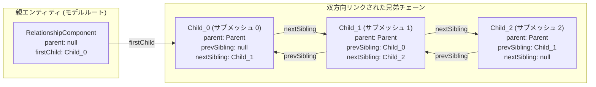
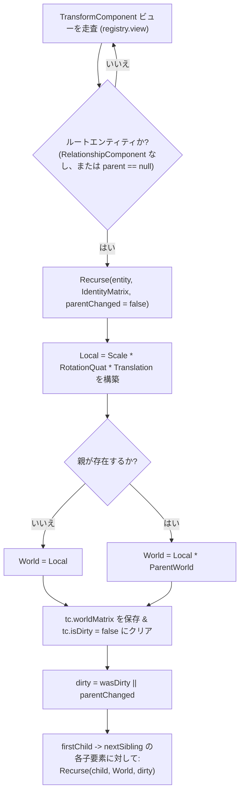
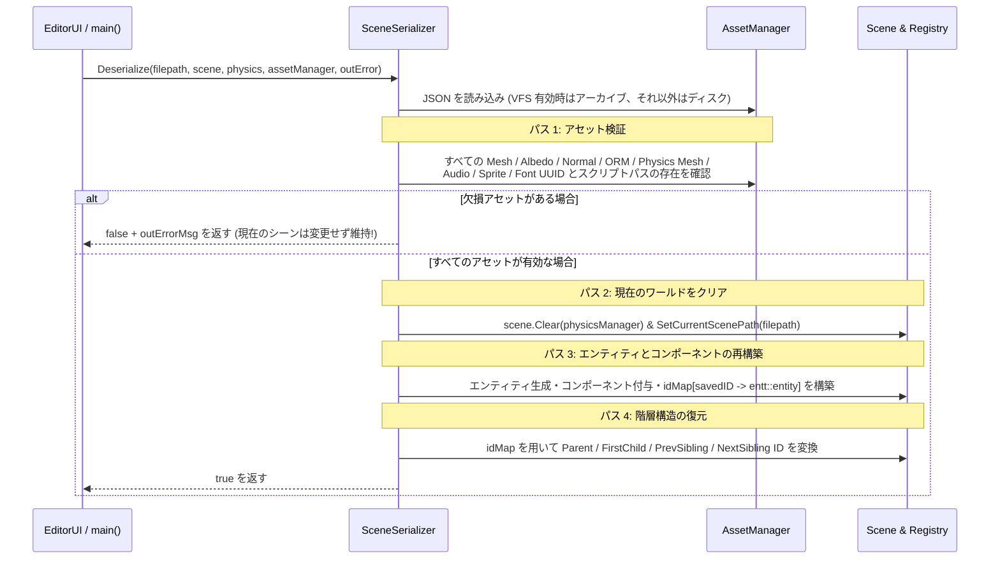

# ECS とエンティティ管理

Step Engine は、シーングラフ (`Engine::Scene`) の中核として **EnTT** (`entt::registry`) を採用しています。エンティティは軽量な 32 ビットハンドル (`entt::entity`) で表現され、コンポーネントは連続したスパースセットに格納される POD (Plain-Old-Data) 構造体 (`include/Engine/Components.h`)、振る舞いは `include/Engine/Systems.h` 内のステートレスな関数群として実装されています。

---

## コンポーネント構成の概要

`Scene::CreateEntity` で生成されるすべてのエンティティには、以下の3つの基本コンポーネントが自動的に付与されます。

1. **`IDComponent`** — セーブ・ロード間でエンティティのシリアライズや階層構造の復元を行うための永続的な 64 ビット `id` です。
2. **`NameComponent`** — 人間が判読可能な表示名 `name` と、エンティティ全体の有効・無効を切り替えるマスターフラグ `isActive` を保持します。各システム（`RenderSystem`、`PhysicsSystem`、`AudioSystem`、`Scene::CastRay`）は `NameComponent::isActive` が `false` のエンティティをスキップします。
3. **`TransformComponent`** — ローカル空間の位置 (`position`)、クォータニオン回転 (`rotation`)、スケール (`scale`)、キャッシュされた `worldMatrix`、および更新フラグ `isDirty` を保持します。

機能拡張用の各種コンポーネントは、C++ コード、エディタの **Inspector**、または実行時の Lua スクリプトから自由に追加できます。

| カテゴリ | コンポーネント | 使用するシステム |
| :--- | :--- | :--- |
| **階層構造** | `RelationshipComponent` | `TransformSystem`, `Scene`, `EditorUI`, `SceneSerializer` |
| **3D レンダリング** | `MeshRendererComponent`, `LightComponent` | `RenderSystem::DrawEntities` |
| **カメラ** | `CameraComponent`, `ViewportComponent`, `EditorCamControlComponent` | `EditorCameraInputSystem`, `CameraMatrixSystem`, `RenderSystem` |
| **物理演算** | `RigidBodyComponent` | `PhysicsSystem`, `RenderSystem::DrawDebugColliders`, `Scene::CastRay` |
| **スクリプティング** | `LuaScriptComponent` (`std::vector<ScriptInstance>`) | `ScriptSystemInit`, `ScriptSystemUpdate`, `ScriptSystemShutdown`, `PhysicsContactListener` |
| **オーディオ** | `AudioComponent` | `AudioSystem` |
| **2D UI / HUD** | `SpriteRendererComponent`, `TextRendererComponent` | `RenderSystem::DrawUI` |

各フィールドの正確な定義とデフォルト値については、[ECS コンポーネントと列挙型](../api/components.md) を参照してください。

---

## 侵入型エンティティ階層 (`RelationshipComponent`)

エンティティごとにヒープ確保された `std::vector<entt::entity>` の子リストを持つ代わりに、Step Engine は4つの `entt::entity` ハンドルを用いた侵入型（Intrusive）リストによって、ノードあたり O(1) のメモリ使用量で親子ツリーを構築しています。

- `parent` — 親エンティティ（ルートの場合は `entt::null`）。
- `firstChild` — 親が持つ双方向子リストの先頭要素。
- `prevSibling` / `nextSibling` — 同じ `parent` を共有する前後の兄弟エンティティ。



### ワールド変換を維持する親子付けと親子解除

`Scene::ParentEntity(child, parent)` および `Scene::UnparentEntity(child)` は、親エンティティを変更した際にもワールド空間での見た目上の位置・回転・スケールが変化しないよう自動変換を行います。

1. **循環参照の検出**: `ParentEntity` は `parent` から `RelationshipComponent::parent` ポインタを上方向に辿ります。`parent` の祖先に `child` が含まれている場合（または `child == parent` の場合）、`TransformSystem` での無限ループを防ぐため処理を即座に中断します。
2. **親からの切り離し (`UnparentEntity`)**: 旧親の `firstChild` ポインタを修復し、`prevSibling` / `nextSibling` を繋ぎ直します。さらに `child` のキャッシュ済み `worldMatrix` をローカルの `scale`、`rotation`、`position` へ直接分解し、`RelationshipComponent` の各リンクを `entt::null` にクリアします。
3. **ローカル空間への再変換 (`ParentEntity`)**: 新しい `parent` に対する相対ローカル行列を計算します。
   ```text
   M_local = M_childWorld * Inverse(M_parentWorld)
   ```
   `DirectX::XMMatrixDecompose` によって更新後のローカル `scale`、`rotation`、`position` を `child` の `TransformComponent` に格納し、`isDirty = true` を設定します。
4. **兄弟リスト末尾への追加**: 両エンティティに `RelationshipComponent` がなければ追加し、`parent` の子リスト末尾へ `child` を連結します。

---

## 階層的トランスフォーム伝播 (`TransformSystem`)

`TransformSystem(Scene&)` は毎フレーム、物理演算・スクリプト・カメラ入力の処理後に実行され、描画前にすべての `TransformComponent::worldMatrix` を最新の状態へ更新します。



- **行優先 (Row-Major) 規約**: Step Engine は全体を通して `DirectXMath` の行優先規約（`Local = S * R * T` および `World = Local * ParentWorld`）を採用しており、HLSL シェーダー内の `row_major float4x4` 行列および `mul(rowVector, Matrix)` と一致しています。

---

## エンティティの生成・破棄・遅延破棄キュー

### `Scene` のファクトリヘルパー

- **プリミティブと空エンティティ**: `CreateEntity`、`CreateCube`、`CreateSphere`、`CreateCapsule`、`CreateSampleEntity`。
- **カメラとライト**: `CreateEditorCamera`、`CreateGameCamera`、`CreateDirectionalLight`、`CreatePointLight`、`CreateSpotLight`。
- **マルチメッシュモデルのインスタンス化 (`Scene::InstantiateModel`)**: `MeshManager::LoadModel` を介して `.obj`、`.fbx`、`.gltf`、`.glb` ファイルを解析し、ファイル名（拡張子なし、例: `ABeautifulGame`）を持つルートエンティティを生成した上で、各サブメッシュに対応する子エンティティ (`<stem>_mesh_<i>`) を `MeshRendererComponent` 付きで親子付けします。

### カスケード即時破棄 (`Scene::DestroyEntity`)

`Scene::DestroyEntity(entity, physicsManager)` を呼び出すと、対象サブツリー全体が安全にクリーンアップされます。

1. **子孫の再帰的破棄**: `firstChild -> nextSibling` を走査し（再帰呼び出し前に `nextSibling` をキャッシュ）、すべての子孫を深さ優先で破棄します。
2. **階層リンクの解除**: `UnparentEntity(entity)` を呼び出して親の兄弟リストを修復します。
3. **物理ボディの削除**: `PhysicsManager::RemoveRigidBody` により関連付けられた Jolt `BodyID` を削除・破棄します。
4. **Lua `OnDestroy` フックの実行**: エンティティにアタッチされた初期化済み全スクリプトの `OnDestroy()` を `sol::protected_function` 経由で呼び出します。
5. **レジストリからの削除**: `registry.destroy(entity)` を呼び出します。

### 遅延破棄キュー (`SubmitForDestruction`)

Lua スクリプトの更新ループ中に `DestroyEntity` を直接呼び出すと、イテレータ無効化を引き起こす恐れがあります。そのため、`Entity:Destroy(delay)` は `Scene::SubmitForDestruction(entity, delay)` を呼び出し、`Scene::m_entitiesToDestroy` に `{entity, delay}`（重複登録防止付き）をキューイングします。

Play モード中、`ScriptSystemUpdate` と `AudioSystem` の完了後に `Scene::ProcessDestructionQueue(physicsManager, deltaTime)` が実行され、末尾から逆順にタイマーを減算して `timeRemaining <= 0.0f` となったエンティティに対して安全に `DestroyEntity` を実行します。

---

## 4パス・シーンシリアライズ (`SceneSerializer`)

`SceneSerializer` (`src/Engine/SceneSerializer.cpp`) は RapidJSON を用いてシーンを JSON 形式で保存・復元します。その際、実行時の一時的な `entt::entity` ハンドルを永続的な 64 ビット `IDComponent` 値およびアセット `UUID` ハンドルへ変換します。


