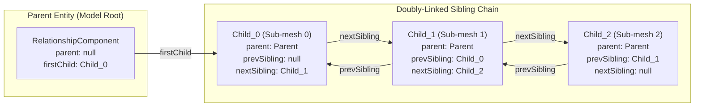
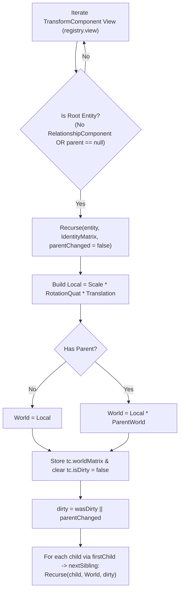
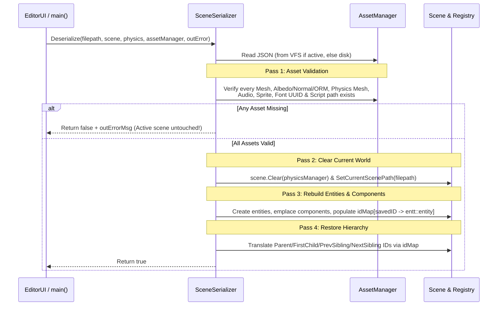

# ECS & Entity Management

Step Engine uses **EnTT** (`entt::registry`) as the backbone of its scene graph (`Engine::Scene`). Entities are lightweight 32-bit handles (`entt::entity`), components are Plain-Old-Data (POD) structs stored in contiguous sparse sets (`include/Engine/Components.h`), and behavior lives in stateless functions inside `include/Engine/Systems.h`.

---

## Component Architecture Overview

Every entity created via `Scene::CreateEntity` automatically receives three foundational components:

1. **`IDComponent`** — A persistent 64-bit `id` used to serialize entities and rebuild hierarchies across save/load cycles.
2. **`NameComponent`** — A human-readable `name` string and the master entity activation flag `isActive`. Systems (`RenderSystem`, `PhysicsSystem`, `AudioSystem`, `Scene::CastRay`) skip entities whose `NameComponent::isActive` is `false`.
3. **`TransformComponent`** — Local-space translation (`position`), quaternion orientation (`rotation`), `scale`, a cached `worldMatrix`, and an `isDirty` flag.

Optional capability components can be attached in C++, through the Editor **Inspector**, or at runtime from Lua:

| Category | Components | Consuming Systems |
| :--- | :--- | :--- |
| **Hierarchy** | `RelationshipComponent` | `TransformSystem`, `Scene`, `EditorUI`, `SceneSerializer` |
| **3D Rendering** | `MeshRendererComponent`, `LightComponent` | `RenderSystem::DrawEntities` |
| **Cameras** | `CameraComponent`, `ViewportComponent`, `EditorCamControlComponent` | `EditorCameraInputSystem`, `CameraMatrixSystem`, `RenderSystem` |
| **Physics** | `RigidBodyComponent` | `PhysicsSystem`, `RenderSystem::DrawDebugColliders`, `Scene::CastRay` |
| **Scripting** | `LuaScriptComponent` (`std::vector<ScriptInstance>`) | `ScriptSystemInit`, `ScriptSystemUpdate`, `ScriptSystemShutdown`, `PhysicsContactListener` |
| **Audio** | `AudioComponent` | `AudioSystem` |
| **2D UI / HUD** | `SpriteRendererComponent`, `TextRendererComponent` | `RenderSystem::DrawUI` |

For exact field definitions and default values, see [ECS Components & Enums](../api/components.md).

---

## Intrusive Entity Hierarchy (`RelationshipComponent`)

Rather than storing heap-allocated `std::vector<entt::entity>` child arrays on every entity, Step Engine links parent-child trees intrusively in O(1) memory per node using four `entt::entity` handles:

- `parent` — The parent entity (`entt::null` if root).
- `firstChild` — Head of the parent's doubly-linked child list.
- `prevSibling` / `nextSibling` — Adjacent children sharing the same `parent`.



### World-Preserving Reparenting & Unparenting

`Scene::ParentEntity(child, parent)` and `Scene::UnparentEntity(child)` keep an entity visually stationary in world space when its hierarchy parent changes:

1. **Cycle Detection**: `ParentEntity` walks upward from `parent` through `RelationshipComponent::parent` pointers. If `child` is encountered as an ancestor of `parent` (or `child == parent`), the operation aborts immediately to prevent infinite loops in `TransformSystem`.
2. **Detachment (`UnparentEntity`)**: Repairs the old parent's `firstChild` pointer and splices `prevSibling` / `nextSibling` around `child`. Decomposes `child`'s cached `worldMatrix` directly into local `scale`, `rotation`, and `position`, and clears its `RelationshipComponent` links to `entt::null`.
3. **Local Space Conversion (`ParentEntity`)**: Computes the new local matrix relative to `parent`:
   ```text
   M_local = M_childWorld * Inverse(M_parentWorld)
   ```
   `DirectX::XMMatrixDecompose` extracts the updated local `scale`, `rotation`, and `position` into `child`'s `TransformComponent` and sets `isDirty = true`.
4. **Sibling Appending**: Emplaces `RelationshipComponent` on both entities if absent and appends `child` to the tail of `parent`'s child list.

---

## Hierarchical Transform Propagation (`TransformSystem`)

`TransformSystem(Scene&)` runs every frame after physics, scripts, and camera input, ensuring `TransformComponent::worldMatrix` is up-to-date before rendering.



- **Row-Major Convention**: Step Engine uses `DirectXMath` row-major conventions throughout (`Local = S * R * T` and `World = Local * ParentWorld`), matching `row_major float4x4` matrices and `mul(rowVector, Matrix)` in HLSL shaders.

---

## Entity Creation, Destruction & Deferred Queue

### Factory Helpers on `Scene`

- **Primitives & Empty Entities**: `CreateEntity`, `CreateCube`, `CreateSphere`, `CreateCapsule`, `CreateSampleEntity`.
- **Cameras & Lights**: `CreateEditorCamera`, `CreateGameCamera`, `CreateDirectionalLight`, `CreatePointLight`, `CreateSpotLight`.
- **Multi-Mesh Model Instantiation (`Scene::InstantiateModel`)**: Parses a `.obj`, `.fbx`, `.gltf`, or `.glb` file via `MeshManager::LoadModel`, creates a root entity named after the file stem (e.g., `ABeautifulGame`), and parents one child entity (`<stem>_mesh_<i>`) per sub-mesh with a pre-configured `MeshRendererComponent`.

### Cascading Immediate Destruction (`Scene::DestroyEntity`)

Calling `Scene::DestroyEntity(entity, physicsManager)` safely cleans up an entire subtree:

1. **Recursive Children First**: Iterates `firstChild -> nextSibling` (caching `nextSibling` before recursion) and destroys every descendant depth-first.
2. **Hierarchy Unlink**: Calls `UnparentEntity(entity)` to repair the parent's sibling list.
3. **Physics Cleanup**: Removes and destroys any associated Jolt `BodyID` via `PhysicsManager::RemoveRigidBody`.
4. **Lua `OnDestroy` Hook**: Invokes `OnDestroy()` via `sol::protected_function` on all initialized scripts attached to the entity.
5. **Registry Erasure**: Calls `registry.destroy(entity)`.

### Deferred Destruction Queue (`SubmitForDestruction`)

Lua scripts cannot safely call `DestroyEntity` mid-iteration without risking iterator invalidation. Instead, `Entity:Destroy(delay)` calls `Scene::SubmitForDestruction(entity, delay)`, appending `{entity, delay}` (deduplicated) to `Scene::m_entitiesToDestroy`.

During Play Mode, `Scene::ProcessDestructionQueue(physicsManager, deltaTime)` runs after `ScriptSystemUpdate` and `AudioSystem`, decrementing timers in reverse index order and calling `DestroyEntity` once `timeRemaining <= 0.0f`.

---

## 4-Pass Scene Serialization (`SceneSerializer`)

`SceneSerializer` (`src/Engine/SceneSerializer.cpp`) persists scenes to JSON via RapidJSON while translating transient `entt::entity` handles into stable 64-bit `IDComponent` values and asset `UUID` handles.


