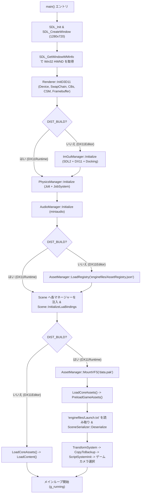
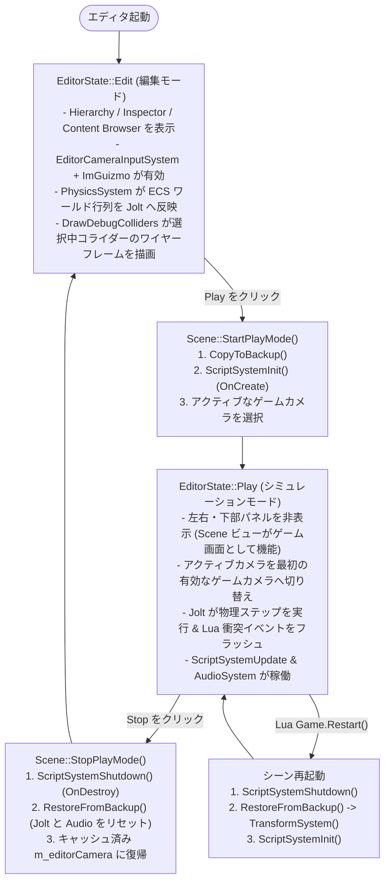

# コアエンジンループとライフサイクル

アプリケーションのエントリポイントおよびフレーム全体の制御は `src/main.cpp` に実装されています。`DX11Editor` と `DX11Runtime` はどちらも同じ `main()` 関数からコンパイルされ、`DIST_BUILD` マクロによって起動処理、入力ルーティング、シミュレーション状態、およびレンダーターゲットを切り替えます。

---

## デュアルターゲット構成 (`DX11Editor` vs. `DX11Runtime`)

`CMakeLists.txt` では、同一の `ENGINE_SOURCE_FILES` と `ENGINE_HEADER_FILES` から2つの実行ファイルターゲットを定義しています。

| 項目 | `DX11Editor` (デフォルト) | `DX11Runtime` (`DIST_BUILD` 定義時) |
| :--- | :--- | :--- |
| **UI とギズモ** | `ImGuiManager` と `EditorUI` を初期化（`ImGuizmo` 有効） | コンパイル時に除外 (`#ifndef DIST_BUILD`) |
| **アセット読み込み元** | ディスク上の個別ファイル + `enginefiles/AssetRegistry.json` | `AssetManager::MountVFS` でマウントされるパック済みバイナリ (`data.pak`) |
| **初期シーン** | JSON シーンを開くまでプロシージャルなサンドボックス (`LoadContent()`) を生成 | `enginefiles/Launch.txt` から起動シーンパスを読み取り即座にデシリアライズ |
| **シミュレーション状態** | `EditorState::Edit` / `EditorState::Play` トグルで切り替え | `isPlaying` は常に `true` となり、起動直後からスクリプトと物理演算が稼働 |
| **メインレンダーターゲット** | ImGui パネル内に表示されるオフスクリーン `Renderer` フレームバッファ (`RTV` + `SRV`) | スワップチェーンのバックバッファへ直接描画 (`Renderer::BindBackBuffer`) |
| **終了時の台帳保存** | 更新された UUID を `enginefiles/AssetRegistry.json` に書き出し | スキップ（読み取り専用の VFS モード） |

---

## 起動と初期化シーケンス

起動時、`main()` はハードウェアおよび各エンジンマネージャーを厳密な依存関係順に初期化し、シーンエンティティや Lua スクリプトが生成される前に GPU デバイス、物理アロケータ、アセットレジストリが使用可能な状態にします。

### コアアセットのブートストラップ (`LoadCoreAssets`)

ビルドターゲットに関わらず、`LoadCoreAssets()` はエンジン共通の基本リソースを初期化し、`Scene::SetDefaultAssets` を通じてそれらの UUID を `g_scene` にキャッシュします。

1. **フォールバック用 1x1 テクスチャ**: `TextureManager::CreateDefaultTexture` が `primitive://white` (`255, 255, 255, 255`)、`primitive://default_normal` (`128, 128, 255, 255`)、`primitive://default_orm` (`255, 128, 0, 255`) を生成します。
2. **コアシェーダー**: `ShaderManager` が `shader://basic`、`shader://unlit`、`shader://skybox`、`shader://shadow`、`shader://sprite` をロードします。
3. **プロシージャルプリミティブ**: `MeshManager` が `primitive://cube`、`primitive://sphere_...`、`primitive://capsule_...`、`primitive://quad` の頂点・インデックスバッファを構築します。
4. **デフォルトスカイボックス**: `TextureManager::LoadCubemap` が `assets/Textures/Skybox/` 配下の6面画像（`right`, `left`, `top`, `bottom`, `front`, `back`）を読み込み、`Renderer::SetSkybox` で SRV を設定します。

> **UUID の一貫性に関する補足:** `DX11Editor` では、`LoadCoreAssets()` より **前に** `AssetManager::LoadRegistry("enginefiles/AssetRegistry.json")` が実行されます。これにより、`primitive://cube` などの仮想パスに対しても既存の JSON シーンファイルに保存されている 64 ビット UUID がそのまま再利用されます。

---

## フレーム実行ループ

フレーム間の経過時間 (`dt`) は、SDL2 の高精度パフォーマンスカウンタ (`SDL_GetPerformanceCounter` / `SDL_GetPerformanceFrequency`) を用いて秒単位で算出されます。`while (g_running)` の各イテレーションは、**イベントポーリング**、**シミュレーション更新**、**マルチパスレンダリング**、**アプリケーション制御** の4フェーズで構成されます。

```mermaid
flowchart TD
    Start["フレーム開始"] --> InputBegin["InputManager::BeginFrame()<br/>前フレームのキー状態を保存 & マウス移動量をリセット"]
    InputBegin --> Poll["SDL_Event キューをポーリング"]
    Poll --> Route{"イベント振り分け"}
    Route --> EscCheck["ESC / SDL_QUIT -> g_running = false<br/>SDL_WINDOWEVENT_SIZE_CHANGED -> Renderer::Resize"]
    Route --> ImGuiRoute["Editor: ImGuiManager::ProcessEvent(e)<br/>未キャプチャ時・右クリック飛行カメラ中・Scene フォーカス時・SDL_KEYUP 時は InputManager へ転送"]
    EscCheck --> CalcDT["SDL_GetPerformanceCounter で dt を算出"]
    ImGuiRoute --> CalcDT

    subgraph UpdateStep ["Update(dt)"]
        direction TB
        U1["1. PhysicsSystem(dt, isPlaying)<br/>ボディ生成・破棄 / Jolt ステップ実行 & 変換同期 (Play) またはギズモ変換の反映 (Edit)"]
        U2["2. ScriptSystemUpdate(scene, dt) [Play のみ]<br/>Time.deltaTime 更新、動的追加スクリプトの遅延初期化、OnUpdate(dt) 実行"]
        U3["3. AudioSystem(scene, audio, assets) [Play のみ]<br/>3D カメラリスナーとエミッターのワールド座標を同期"]
        U4["4. Scene::ProcessDestructionQueue(physics, dt) [Play のみ]<br/>タイマー減算 & 期限切れエンティティのカスケード破棄"]
        U5["5. EditorCameraInputSystem(scene, input, dt) [Edit のみ]<br/>右クリック視点回転、ホイールズーム、WASD + LShift 飛行移動"]
        U6["6. TransformSystem(scene)<br/>RelationshipComponent ツリーに沿って Local -> World 行列を伝播"]
        U7["7. CameraMatrixSystem(scene, renderer)<br/>アクティブカメラの View (b1) / Projection (b0) 行列をアップロード"]
        U1 --> U2 --> U3 --> U4 --> U5 --> U6 --> U7
    end

    CalcDT --> UpdateStep
    UpdateStep --> RenderStep

    subgraph RenderStep ["Render()"]
        direction TB
        R1["Editor: ImGuiManager::BeginFrame & EditorUI::Render<br/>オフスクリーン Framebuffer をバインド (Runtime では BackBuffer)"]
        R2["RenderSystem::DrawEntities<br/>パス 1: 3分割カスケードシャドウマップ -> パス 2: フォワード PBR / Unlit 3D メッシュ"]
        R3["RenderSystem::DrawDebugColliders [Editor Edit モードのみ]"]
        R4["Renderer::DrawSkybox (z = w 深度トリック)"]
        R5["RenderSystem::DrawUI (平行投影 2D スプライト & TTF テキスト)"]
        R6["Editor: BindBackBuffer & ImGuiManager::EndFrame"]
        R7["Renderer::Present(g_vSync)"]
        R1 --> R2 --> R3 --> R4 --> R5 --> R6 --> R7
    end

    RenderStep --> AppCtrl{"シーン制御フラグ"}
    AppCtrl -- "m_requestQuit" --> Exit["シャットダウン処理"]
    AppCtrl -- "m_requestRestart" --> Restart["ScriptSystemShutdown -> RestoreFromBackup -> TransformSystem -> ScriptSystemInit"]
    AppCtrl -- "継続" --> Start
    Restart --> Start
```

### エディタモードにおけるスマート入力ルーティング

`DX11Editor` 実行中は、`ImGuiManager::ProcessEvent` によって `Dear ImGui` が最初に `SDL_Event` を受け取ります。3D ビューポート操作中にカメラ制御がブロックされたり、キー押しっぱなし状態が残ったりするのを防ぐため、以下の制御を行っています。

1. `!imguiCaptured`、`g_input.IsMouseCaptured()`（右クリック飛行カメラ中）、`g_editorUI.IsSceneFocused()`、または `e.type == SDL_KEYUP`（キー押下中にフォーカスが外れた際のスタック防止）のいずれかを満たす場合、イベントは引き続き `InputManager::ProcessEvent` に渡されます。
2. `Render()` 中、`g_input.IsMouseCaptured()` が `true` の場合は `ImGuiIO` に `ImGuiConfigFlags_NoMouse` が設定され、カメラ飛行中のマウス移動によって ImGui ウィジェットが誤ってホバー・クリックされるのを防ぎます。

---

## エディタステートマシン (`Edit` <-> `Play`)

`EditorUI` は上部の **Toolbar** から切り替え可能な `EditorState` 列挙型（`Edit` または `Play`）を保持しています。Play モード開始時にインメモリスナップショットを作成するため、実行中の物理挙動、エンティティ生成、スクリプトによる変更が編集済みのシーンデータを破壊することはありません。

### `CopyToBackup` と `RestoreFromBackup` の仕組み

- **`Scene::CopyToBackup()`**: `m_backupRegistry` をクリアした上で `Scene::registry` 内の全エンティティを走査し、`m_backupRegistry.create(entity)` を呼び出して同一の `entt::entity` ID（`RelationshipComponent` のリンクを含む）を維持したまま全14種類のコアコンポーネントを複製します。
- **`Scene::RestoreFromBackup(physicsManager)`**:
    1. `PhysicsManager` から現在アクティブなすべての Jolt `BodyID` を削除・破棄します。
    2. アクティブなすべての `AudioComponent::soundHandle` に対して `AudioManager::DestroyAudio` を呼び出します。
    3. `Scene::registry` をクリアし、バックアップから全エンティティとコンポーネントを再構築します。
    4. 実行時の一時ハンドル（`RigidBodyComponent::bodyID = JPH::BodyID()`、`bodyCreated = false`、`AudioComponent::soundHandle = nullptr`、`isPlaying = false`）を無効化し、次フレームで `PhysicsSystem` と `AudioSystem` が新しいランタイムインスタンスをクリーンに再生成できるようにします。

---

## シャットダウンシーケンス

メインループ終了時（`ESC` キー、ウィンドウクローズ、または `Game.Quit()`）には、以下の順序で終了処理が行われます。

1. **アセットレジストリの保存** *(Editor のみ)*: `g_assetManager.SaveRegistry("enginefiles/AssetRegistry.json")` により、認識されたすべてのアセット UUID をディスクへ永続化します。
2. **シーンのクリア**: `g_scene.Clear(g_physicsManager)` により、すべての Jolt ボディ削除、`miniaudio` サウンドインスタンス破棄、および EnTT レジストリのクリアを行います。
3. **サブシステムの終了処理**: 依存関係の逆順で各マネージャーをシャットダウンします：
   `AudioManager::Shutdown()` -> `PhysicsManager::Shutdown()` -> `FontManager::Shutdown()` -> `ImGuiManager::Shutdown()` *(Editor のみ)* -> `Renderer::Shutdown()` -> `SDL_DestroyWindow` & `SDL_Quit()`。
