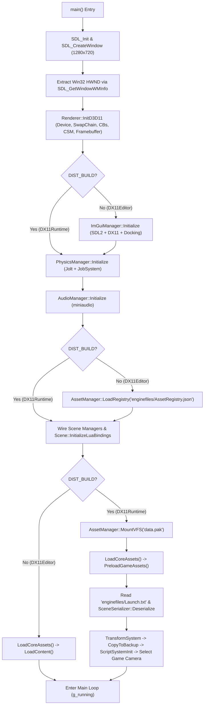
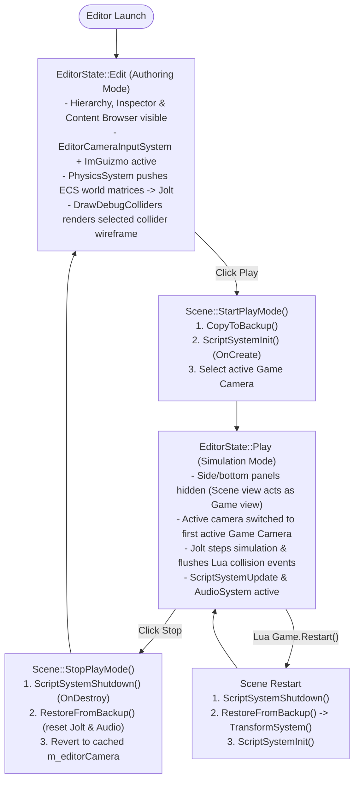

# Core Engine Loop & Lifecycle

The application entry point and frame orchestration live in `src/main.cpp`. Both `DX11Editor` and `DX11Runtime` compile from the same `main()` function, using the `DIST_BUILD` macro to specialize startup, input routing, simulation state, and render targets.

---

## Dual-Target Architecture (`DX11Editor` vs. `DX11Runtime`)

`CMakeLists.txt` defines two executable targets from the exact same `ENGINE_SOURCE_FILES` and `ENGINE_HEADER_FILES`:

| Aspect | `DX11Editor` (Default) | `DX11Runtime` (`DIST_BUILD` defined) |
| :--- | :--- | :--- |
| **UI & Gizmos** | Initializes `ImGuiManager` and `EditorUI` (`ImGuizmo` enabled) | Excluded at compile time (`#ifndef DIST_BUILD`) |
| **Asset Source** | Loose files on disk + `enginefiles/AssetRegistry.json` | Packed binary archive (`data.pak`) mounted via `AssetManager::MountVFS` |
| **Initial Scene** | Procedural sandbox (`LoadContent()`) until a JSON scene is opened | Reads startup path from `enginefiles/Launch.txt` and deserializes immediately |
| **Simulation Mode** | Controlled by `EditorState::Edit` / `EditorState::Play` toggle | `isPlaying` is permanently `true`; scripts and physics start immediately |
| **Primary Render Target** | Off-screen `Renderer` framebuffer (`RTV` + `SRV`) displayed in ImGui | Direct swap-chain back buffer (`Renderer::BindBackBuffer`) |
| **Shutdown Ledger Save** | Writes updated UUIDs to `enginefiles/AssetRegistry.json` | Skipped (read-only VFS mode) |

---

## Boot & Initialization Sequence

At launch, `main()` initializes hardware and engine managers in strict dependency order so that GPU devices, physics allocators, and asset registries exist before any scene entities or Lua scripts are created.

### Core Asset Bootstrapping (`LoadCoreAssets`)

Regardless of build target, `LoadCoreAssets()` initializes shared engine resources and caches their UUIDs on `g_scene` via `Scene::SetDefaultAssets`:

1. **Fallback 1x1 Textures**: `TextureManager::CreateDefaultTexture` generates `primitive://white` (`255, 255, 255, 255`), `primitive://default_normal` (`128, 128, 255, 255`), and `primitive://default_orm` (`255, 128, 0, 255`).
2. **Core Shaders**: `ShaderManager` loads `shader://basic`, `shader://unlit`, `shader://skybox`, `shader://shadow`, and `shader://sprite`.
3. **Procedural Primitives**: `MeshManager` builds vertex/index buffers for `primitive://cube`, `primitive://sphere_...`, `primitive://capsule_...`, and `primitive://quad`.
4. **Default Skybox**: `TextureManager::LoadCubemap` loads the 6 faces under `assets/Textures/Skybox/` (`right`, `left`, `top`, `bottom`, `front`, `back`) and binds the resulting SRV via `Renderer::SetSkybox`.

> **UUID Stability Note:** In `DX11Editor`, `AssetManager::LoadRegistry("enginefiles/AssetRegistry.json")` runs *before* `LoadCoreAssets()` so virtual paths such as `primitive://cube` reuse the exact same 64-bit UUIDs saved inside existing JSON scene files.

---

## Per-Frame Execution Loop

Frame delta time (`dt`) is computed in seconds using SDL2's hardware performance counter (`SDL_GetPerformanceCounter` / `SDL_GetPerformanceFrequency`). Each iteration of `while (g_running)` executes four phases: **Event Polling**, **Simulation Update**, **Multi-Pass Rendering**, and **Application Control**.

```mermaid
flowchart TD
    Start["Frame Start"] --> InputBegin["InputManager::BeginFrame()<br/>Snapshot previous keys & zero mouse deltas"]
    InputBegin --> Poll["Poll SDL_Event Queue"]
    Poll --> Route{"Event Routing"}
    Route --> EscCheck["ESC / SDL_QUIT -> g_running = false<br/>SDL_WINDOWEVENT_SIZE_CHANGED -> Renderer::Resize"]
    Route --> ImGuiRoute["Editor: ImGuiManager::ProcessEvent(e)<br/>Forward to InputManager if uncaptured, RMB fly-cam active, Scene focused, or SDL_KEYUP"]
    EscCheck --> CalcDT["Compute dt via SDL_GetPerformanceCounter"]
    ImGuiRoute --> CalcDT

    subgraph UpdateStep ["Update(dt)"]
        direction TB
        U1["1. PhysicsSystem(dt, isPlaying)<br/>Create/remove bodies; step Jolt & pull transforms (Play) or push gizmo transforms (Edit)"]
        U2["2. ScriptSystemUpdate(scene, dt) [Play only]<br/>Update Time.deltaTime, lazy-init runtime scripts, run OnUpdate(dt)"]
        U3["3. AudioSystem(scene, audio, assets) [Play only]<br/>Sync 3D camera listener & emitter world positions"]
        U4["4. Scene::ProcessDestructionQueue(physics, dt) [Play only]<br/>Tick timers & cascade-destroy expired entities"]
        U5["5. EditorCameraInputSystem(scene, input, dt) [Edit only]<br/>RMB mouse-look, scroll zoom, WASD + LShift fly movement"]
        U6["6. TransformSystem(scene)<br/>Cascade Local -> World matrices down RelationshipComponent trees"]
        U7["7. CameraMatrixSystem(scene, renderer)<br/>Upload active camera View (b1) and Projection (b0) matrices"]
        U1 --> U2 --> U3 --> U4 --> U5 --> U6 --> U7
    end

    CalcDT --> UpdateStep
    UpdateStep --> RenderStep

    subgraph RenderStep ["Render()"]
        direction TB
        R1["Editor: ImGuiManager::BeginFrame & EditorUI::Render<br/>Bind off-screen Framebuffer (or BackBuffer in Runtime)"]
        R2["RenderSystem::DrawEntities<br/>Pass 1: 3-Cascade Shadow Maps -> Pass 2: Forward PBR / Unlit 3D Meshes"]
        R3["RenderSystem::DrawDebugColliders [Editor Edit Mode only]"]
        R4["Renderer::DrawSkybox (z = w depth trick)"]
        R5["RenderSystem::DrawUI (Orthographic 2D Sprites & TTF Text)"]
        R6["Editor: BindBackBuffer & ImGuiManager::EndFrame"]
        R7["Renderer::Present(g_vSync)"]
        R1 --> R2 --> R3 --> R4 --> R5 --> R6 --> R7
    end

    RenderStep --> AppCtrl{"Scene Control Flags"}
    AppCtrl -- "m_requestQuit" --> Exit["Shutdown Sequence"]
    AppCtrl -- "m_requestRestart" --> Restart["ScriptSystemShutdown -> RestoreFromBackup -> TransformSystem -> ScriptSystemInit"]
    AppCtrl -- "Continue" --> Start
    Restart --> Start
```

### Smart Input Routing in Editor Mode

When `DX11Editor` is running, `Dear ImGui` intercepts `SDL_Event` messages first via `ImGuiManager::ProcessEvent`. To prevent camera controls from getting stuck or blocked while interacting with the 3D viewport:

1. `InputManager::ProcessEvent` still receives events whenever `!imguiCaptured`, `g_input.IsMouseCaptured()` (right-click fly mode), `g_editorUI.IsSceneFocused()`, or `e.type == SDL_KEYUP` (preventing stuck keys if focus shifts while a key is held).
2. During `Render()`, if `g_input.IsMouseCaptured()` is true, `ImGuiConfigFlags_NoMouse` is set on `ImGuiIO` so cursor motion while flying the camera cannot accidentally hover or click ImGui widgets.

---

## Editor State Machine (`Edit` <-> `Play`)

`EditorUI` maintains an `EditorState` enum (`Edit` or `Play`) toggled from the top **Toolbar**. Entering Play Mode performs an in-memory snapshot so runtime physics forces, spawned entities, and script mutations never corrupt the authored scene.

### How `CopyToBackup` and `RestoreFromBackup` Work

- **`Scene::CopyToBackup()`**: Clears `m_backupRegistry` and iterates every entity in `Scene::registry`, calling `m_backupRegistry.create(entity)` to preserve the exact `entt::entity` identifier (including `RelationshipComponent` links) before copying all 14 core component types.
- **`Scene::RestoreFromBackup(physicsManager)`**:
    1. Removes and destroys all active Jolt `BodyID` instances from `PhysicsManager`.
    2. Calls `AudioManager::DestroyAudio` on all active `AudioComponent::soundHandle` instances.
    3. Clears `Scene::registry` and recreates every backed-up entity and component.
    4. Resets transient runtime handles (`RigidBodyComponent::bodyID = JPH::BodyID()`, `bodyCreated = false`, `AudioComponent::soundHandle = nullptr`, `isPlaying = false`) so `PhysicsSystem` and `AudioSystem` cleanly rebuild fresh runtime instances on the next frame.

---

## Ordered Shutdown Sequence

When the main loop exits (`ESC`, window close, or `Game.Quit()`):

1. **Save Asset Registry** *(Editor only)*: `g_assetManager.SaveRegistry("enginefiles/AssetRegistry.json")` persists all known asset UUIDs.
2. **Clear Scene**: `g_scene.Clear(g_physicsManager)` removes every Jolt body, destroys every `miniaudio` sound instance, and clears the EnTT registry.
3. **Subsystem Teardown**: Shuts down managers in reverse dependency order:
   `AudioManager::Shutdown()` -> `PhysicsManager::Shutdown()` -> `FontManager::Shutdown()` -> `ImGuiManager::Shutdown()` *(Editor only)* -> `Renderer::Shutdown()` -> `SDL_DestroyWindow` & `SDL_Quit()`.
