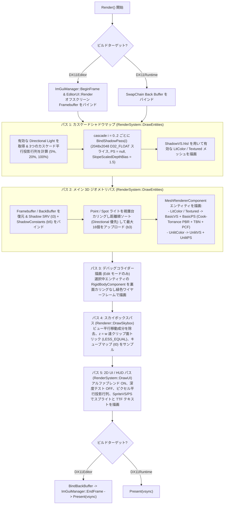

# レンダリングパイプラインとシェーダー

Step Engine は、`Engine::Renderer` (`src/Engine/Renderer.cpp`) にカプセル化されたマルチパス **DirectX 11** フォワードレンダラーを実装しており、毎フレーム `Engine::RenderSystem` (`src/Engine/Systems.cpp`) と HLSL Shader Model 5.0 プログラム (`shaders/*.hlsl`) によって駆動されます。

---

## レンダーターゲット：エディタ用フレームバッファ vs. スタンドアロン用バックバッファ

`Renderer::InitD3D11` はハードウェア `ID3D11Device`、イミディエイト `ID3D11DeviceContext`、および `DXGI_FORMAT_D24_UNORM_S8_UINT` 深度ステンシルバッファを備えたダブルバッファ構成の `DXGI_FORMAT_R8G8B8A8_UNORM` スワップチェーンを生成します。

- **エディタビルド (`DX11Editor`)**: `Renderer::CreateFramebuffer` が独立したオフスクリーン `R8G8B8A8_UNORM` カラーテクスチャ (`D3D11_BIND_RENDER_TARGET | D3D11_BIND_SHADER_RESOURCE`) と `D24_UNORM_S8_UINT` 深度バッファを確保します。3D ジオメトリ、デバッグワイヤーフレーム、スカイボックス、2D HUD 要素はすべてこのオフスクリーンターゲット (`BindFramebuffer()`) に描画され、`EditorUI::DrawSceneView` がドッキング可能な Dear ImGui ウィンドウ内に `ImGui::Image(renderer.GetFramebufferSRV(), viewportSize)` で表示します。ImGui の Scene パネルをリサイズすると、`ViewportComponent` とオフスクリーンフレームバッファの両方が動的にリサイズされます。
- **スタンドアロンビルド (`DX11Runtime`, `DIST_BUILD`)**: すべてのパスがスワップチェーンのバックバッファ (`BindBackBuffer()`) へ直接描画され、ウィンドウのリサイズイベントによってスワップチェーンバッファとアクティブカメラの `ViewportComponent` の両方が更新されます。

---

## マルチパス・フレームパイプライン

`src/main.cpp` の `Render()` 呼び出しでは、毎フレーム以下の GPU パスが順番に実行されます。



---

## GPU レジスタおよび頂点レイアウトリファレンス

### 頂点構造体 (`Engine::Vertex`)

すべてのプロシージャルプリミティブおよび Assimp でインポートされたメッシュは、統一された 44 バイト (`sizeof(Vertex)`)・32 ビットインデックス (`DXGI_FORMAT_R32_UINT`) の頂点フォーマットを使用します。

| セマンティクス | HLSL 型 | DXGI フォーマット | バイトオフセット | 説明 |
| :--- | :--- | :--- | :--- | :--- |
| `POSITION` | `float3` | `DXGI_FORMAT_R32G32B32_FLOAT` | `0` | オブジェクト空間の頂点座標 |
| `NORMAL` | `float3` | `DXGI_FORMAT_R32G32B32_FLOAT` | `12` | オブジェクト空間のサーフェス法線 |
| `TEXCOORD` | `float2` | `DXGI_FORMAT_R32G32_FLOAT` | `24` | UV 座標（Assimp の `aiProcess_FlipUVs` 適用済み） |
| `TANGENT` | `float3` | `DXGI_FORMAT_R32G32B32_FLOAT` | `32` (またはアライン位置) | 接線ベクトル (`aiProcess_CalcTangentSpace`) |

### 定数バッファ・テクスチャ・サンプラー

| ステージ & レジスタ | C++ 構造体 / リソース | 使用シェーダー | 用途 |
| :--- | :--- | :--- | :--- |
| **VS `b0`** | `m_cbProjection` (`XMFLOAT4X4`) | `BasicVS`, `UnlitVS`, `SkyboxVS`, `SpriteVS`, `ShadowVS` | カメラ投影行列、2D UI 平行投影行列、またはカスケードの `g_LightViewProj` |
| **VS `b1`** | `m_cbView` (`XMFLOAT4X4`) | `BasicVS`, `UnlitVS`, `SkyboxVS`, `SpriteVS` | カメラビュー行列、回転のみのスカイボックスビュー、またはスプライト・グリフ UV 矩形 (`g_View[0]`) |
| **VS `b2`** | `m_cbWorld` (`XMFLOAT4X4`) | `BasicVS`, `UnlitVS`, `SkyboxVS`, `SpriteVS`, `ShadowVS` | エンティティのワールド行列または 2D ピクセル変換行列 |
| **PS `b0`** | `m_cbColor` (`XMFLOAT4`, 動的) | `UnlitPS`, `SpritePS` | 単色 Unlit カラーまたは 2D スプライト・テキストの RGBA ティント |
| **PS `b3`** | `LightConstants` (`m_cbLight`) | `BasicPS` | カメラワールド座標、有効ライト数、および `LightData[16]` 配列 |
| **PS `b4`** | `MaterialConstants` (`m_cbMaterial`) | `BasicPS` | `baseColor` ティント、スカラーの `roughness` および `metallic` 乗数 |
| **PS `b5`** | `ShadowConstants` (`m_cbShadow`) | `BasicPS` | `cascadeViewProj[3]` 行列および `cascadeSplits` 分割深度 |
| **PS `t0`** | `ID3D11ShaderResourceView` | `BasicPS`, `SkyboxPS`, `SpritePS` | アルベドマップ (`BasicPS`)、キューブマップ (`SkyboxPS`)、またはスプライト・フォントアトラス (`SpritePS`) |
| **PS `t1`** | `ID3D11ShaderResourceView` | `BasicPS` | タンジェント空間法線マップ |
| **PS `t2`** | `ID3D11ShaderResourceView` | `BasicPS` | チャンネルパック済み ORM マップ（`R` = アンビエントオクルージョン、`G` = ラフネス、`B` = メタリック） |
| **PS `t3`** | `m_shadowSRV` (`Texture2DArray`) | `BasicPS` | 3スライス 2048x2048 `R32_FLOAT` カスケードシャドウ深度配列 |
| **PS `s0`** | `m_samplerState` | `BasicPS`, `SkyboxPS`, `SpritePS` | トライリニア・ラップサンプラー (`D3D11_FILTER_MIN_MAG_MIP_LINEAR`, `ADDRESS_WRAP`) |

---

## 物理ベースシェーディング (`BasicVS.hlsl` & `BasicPS.hlsl`)

ライティング対象のサーフェス (`MaterialType::LitColor` および `MaterialType::Textured`) には、メタリック・ラフネスワークフローの **Cook-Torrance マイクロファセット BRDF** が適用されます。

```text
Lo(p, V) = (0.03 * albedo * ao)
         + sum_i [ (kD * albedo / PI + (D * G * F) / (4 * NdotV * NdotL)) * radiance_i * NdotL ]
```

- **法線マッピング (`TBN`)**: `BasicPS.hlsl` では補間された接線 `T` を法線 `N` に対してグラム・シュミット法（`T = normalize(T - dot(T, N) * N)`）で再直交化し、`B = cross(N, T)` を求めて、アンパックされたタンジェント空間法線（`sampled * 2 - 1`）をワールド空間へ変換します。
- **フォールバックの安全性**: `LitColor` モード時（または `Textured` モードでテクスチャスロットが未設定の場合）、`RenderSystem` は `t0`〜`t2` に 1x1 のフォールバックテクスチャ（白のアルベド、フラットな `(128, 128, 255)` 法線、`(255, 128, 0)` ORM）をバインドします。これによりシェーダー内の条件分岐を排除しつつ、前ドローコールからのテクスチャ状態リークを防ぎます。
- **マルチライトのカリングとソート**:
    - `Directional` (`0`)、`Point` (`1`)、`Spot` (`2`) の3種類のライトをサポートします。
    - `RenderSystem::DrawEntities` はアクティブカメラからワールド空間の `DirectX::BoundingFrustum` を構築し、`BoundingSphere(position, range)` を用いて画面外の Point / Spot ライトを視錐台カリングします。
    - 残ったライトはカメラからの距離の二乗でソートされ（Directional ライトは常に先頭に配置されるよう `distSq = -1.0f` が設定されます）、最大 `MAX_LIGHTS` (`16`) 個に制限されます。シーン内に有効なライトが1つも存在しない場合は、フォールバック用の白色ディレクショナルライト (`intensity = 1.0f`) が自動的にアップロードされます。

---

## カスケードシャドウマップ (CSM)

ディレクショナルライトは、3つの視錐台カスケード (`Renderer::NUM_CASCADES = 3`) を用いて広大なシーン全体に影を落とします。

1. **視錐台の分割**: `Renderer::CalculateCascadeMatrices` がアクティブカメラの `[nearClip, farClip]` 範囲を **5%**、**20%**、**100%** の位置で分割します。
2. **境界球による平行投影フィッティング**: 各サブ視錐台について、`Engine::Math::GetFrustumCornersWorldSpace` が 8 個の NDC 頂点をワールド空間へ逆投影します。それら 8 頂点を回転不変な半径 `r` の境界球で囲み、ライト空間の平行投影ボリューム（X/Y は `[-r, r]`、カメラ背後のシャドウキャスターを捉えるためライト方向に `zPadding = 500.0f` を拡張）を構築します。
3. **テクセルスナッピング**: カメラ移動時の影の輪郭のちらつき（シャドウスイミング）を防ぐため、ワールド原点をライト空間へ投影し、シャドウテクセル単位（`2.0f / 2048.0f`）へ丸め込みます。
4. **シャドウアクネ対策とフィルタリング**: ハードウェアラスタライザの `SlopeScaledDepthBias = 1.5f` とシェーダー側の微小バイアス `0.0001f` により自己遮蔽によるシャドウアクネを抑制し、`BasicPS.hlsl` ではカメラ空間の `viewZ` からカスケードスライスを選択して **3x3 Percentage-Closer Filtering (PCF)** (`SampleLevel`) によるソフトシャドウを計算します。

---

## スカイボックス・デバッグコライダー・2D UI パス

- **デバッグコライダーパス (`RenderSystem::DrawDebugColliders`)**: `DX11Editor` の `Edit` モード中、選択中エンティティが有効な `RigidBodyComponent` を持ち `showWireframe == true` の場合のみ実行されます。`m_wireframeRasterizerState` (`D3D11_FILL_WIREFRAME`, `D3D11_CULL_NONE`) に切り替え、コライダーの正確な物理寸法を単色の緑 (`UnlitVS` / `UnlitPS`) で描画します。
- **スカイボックスパス (`Renderer::DrawSkybox`)**: カメラビュー行列から平行移動成分を取り除き、単位キューブを `50.0f` 倍にスケールして面カリングを無効化します。深度比較関数を `D3D11_COMPARISON_LESS_EQUAL` に設定し、`SkyboxVS.hlsl` で `o.pos = float4(p.x, p.y, p.w, p.w)` を出力することで正規化深度を `1.0` に固定し、3D ジオメトリが描画されなかった背景ピクセルのみを塗りつぶします。
- **2D UI / HUD パス (`RenderSystem::DrawUI`)**: `SRC_ALPHA / INV_SRC_ALPHA` アルファブレンドを有効化し、深度テスト・深度書き込みを無効化した上で、左上原点のピクセル平行投影行列 (`XMMatrixOrthographicOffCenterLH(0, width, height, 0, 0, 1)`) を設定します。スプライトとフォントグリフは共通の 1x1 単位クアッド (`primitive://quad`) を使用し、サブ矩形 UV オフセットとスケール `[uOffset, vOffset, uScale, vScale]` を `b1` の第0行 (`g_View[0]`) 経由で `SpriteVS.hlsl` に渡します。

---

## シェーダーコンパイルとバイトコードキャッシュ (`ShaderManager`)

`ShaderManager::GetShaderBytecode` は、エディタ上でのライブ開発とスタンドアロン配布の両方をシームレスに橋渡しします。

- **エディタモード (`!IsVFSActive()`)**: 起動時に `D3DCompileFromFile` を用いて `.hlsl` ソースファイルをコンパイルし（`vs_5_0` / `ps_5_0`、`_DEBUG` ビルド時は `D3DCOMPILE_DEBUG | D3DCOMPILE_SKIP_OPTIMIZATION` を付与）、コンパイル済みバイトコードをディスク上の `shaders/*.cso` に書き出すと同時に `AssetManager` に登録します。これにより `PackAssets` 実行時にコンパイル済みシェーダーが `data.pak` に含まれます。
- **ランタイムモード (`IsVFSActive()`)**: `.hlsl` ソースファイルや実行時コンパイルを必要とせず、`data.pak` からコンパイル済みの `shaders/*.cso` バイトコードを直接読み込みます。
