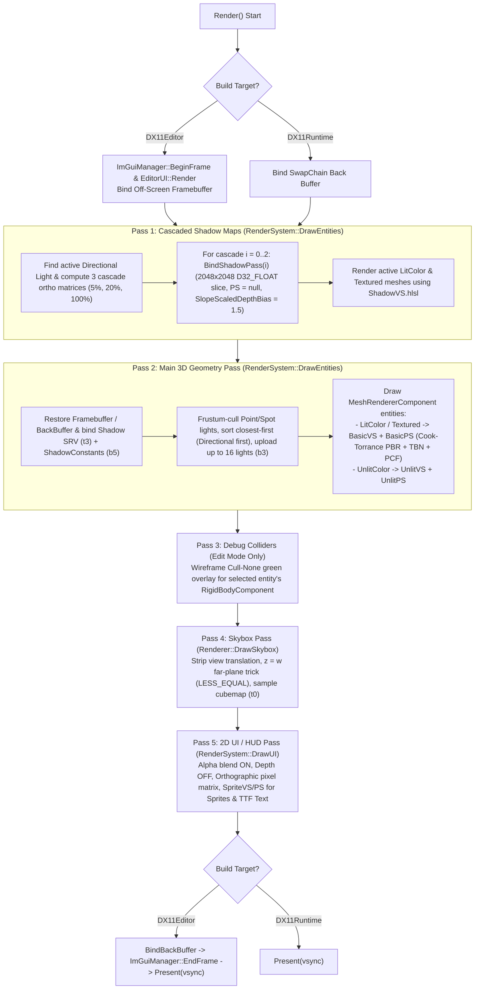

# Rendering Pipeline & Shaders

Step Engine implements a multi-pass **DirectX 11** forward renderer encapsulated by `Engine::Renderer` (`src/Engine/Renderer.cpp`) and driven each frame by `Engine::RenderSystem` (`src/Engine/Systems.cpp`) and HLSL Shader Model 5.0 programs (`shaders/*.hlsl`).

---

## Render Targets: Editor Framebuffer vs. Standalone Back Buffer

`Renderer::InitD3D11` creates a hardware `ID3D11Device`, immediate `ID3D11DeviceContext`, and a double-buffered `DXGI_FORMAT_R8G8B8A8_UNORM` swap chain with a `DXGI_FORMAT_D24_UNORM_S8_UINT` depth-stencil buffer.

- **Editor Builds (`DX11Editor`)**: `Renderer::CreateFramebuffer` allocates an independent off-screen `R8G8B8A8_UNORM` color texture (`D3D11_BIND_RENDER_TARGET | D3D11_BIND_SHADER_RESOURCE`) paired with a `D24_UNORM_S8_UINT` depth buffer. All 3D geometry, debug wireframes, skyboxes, and 2D HUD elements render into this off-screen target (`BindFramebuffer()`), which `EditorUI::DrawSceneView` displays inside a dockable Dear ImGui window via `ImGui::Image(renderer.GetFramebufferSRV(), viewportSize)`. Resizing the ImGui Scene panel dynamically resizes both `ViewportComponent` and the off-screen framebuffer.
- **Standalone Builds (`DX11Runtime`, `DIST_BUILD`)**: All passes render directly to the swap chain back buffer (`BindBackBuffer()`), and window resize events update both the swap chain buffers and the active camera's `ViewportComponent`.

---

## Multi-Pass Frame Pipeline

Each call to `Render()` in `src/main.cpp` executes the following GPU passes in sequence:



---

## GPU Register & Vertex Layout Reference

### Vertex Structure (`Engine::Vertex`)

All procedural primitives and Assimp-imported meshes use a unified 44-byte (`sizeof(Vertex)`) 32-bit indexed (`DXGI_FORMAT_R32_UINT`) vertex format:

| Semantic | HLSL Type | DXGI Format | Byte Offset | Description |
| :--- | :--- | :--- | :--- | :--- |
| `POSITION` | `float3` | `DXGI_FORMAT_R32G32B32_FLOAT` | `0` | Object-space vertex position |
| `NORMAL` | `float3` | `DXGI_FORMAT_R32G32B32_FLOAT` | `12` | Object-space surface normal |
| `TEXCOORD` | `float2` | `DXGI_FORMAT_R32G32_FLOAT` | `24` | UV coordinates (Assimp `aiProcess_FlipUVs` applied) |
| `TANGENT` | `float3` | `DXGI_FORMAT_R32G32B32_FLOAT` | `32` (or aligned) | Tangent vector (`aiProcess_CalcTangentSpace`) |

### Constant Buffers, Textures & Samplers

| Stage & Register | C++ Struct / Resource | Used By Shaders | Purpose |
| :--- | :--- | :--- | :--- |
| **VS `b0`** | `m_cbProjection` (`XMFLOAT4X4`) | `BasicVS`, `UnlitVS`, `SkyboxVS`, `SpriteVS`, `ShadowVS` | Camera projection matrix, orthographic UI matrix, or cascade `g_LightViewProj` |
| **VS `b1`** | `m_cbView` (`XMFLOAT4X4`) | `BasicVS`, `UnlitVS`, `SkyboxVS`, `SpriteVS` | Camera view matrix, rotation-only skybox view, or sprite/glyph UV rect (`g_View[0]`) |
| **VS `b2`** | `m_cbWorld` (`XMFLOAT4X4`) | `BasicVS`, `UnlitVS`, `SkyboxVS`, `SpriteVS`, `ShadowVS` | Entity world matrix or 2D pixel transform |
| **PS `b0`** | `m_cbColor` (`XMFLOAT4`, dynamic) | `UnlitPS`, `SpritePS` | Solid unlit color or 2D sprite/text RGBA tint |
| **PS `b3`** | `LightConstants` (`m_cbLight`) | `BasicPS` | Camera world position, active light count, and `LightData[16]` array |
| **PS `b4`** | `MaterialConstants` (`m_cbMaterial`) | `BasicPS` | `baseColor` tint, scalar `roughness`, and scalar `metallic` multipliers |
| **PS `b5`** | `ShadowConstants` (`m_cbShadow`) | `BasicPS` | `cascadeViewProj[3]` matrices and `cascadeSplits` depths |
| **PS `t0`** | `ID3D11ShaderResourceView` | `BasicPS`, `SkyboxPS`, `SpritePS` | Albedo map (`BasicPS`), Cubemap (`SkyboxPS`), or Sprite/Font atlas (`SpritePS`) |
| **PS `t1`** | `ID3D11ShaderResourceView` | `BasicPS` | Tangent-space Normal map |
| **PS `t2`** | `ID3D11ShaderResourceView` | `BasicPS` | Channel-packed ORM map (`R` = Ambient Occlusion, `G` = Roughness, `B` = Metallic) |
| **PS `t3`** | `m_shadowSRV` (`Texture2DArray`) | `BasicPS` | 3-slice 2048x2048 `R32_FLOAT` cascaded shadow depth array |
| **PS `s0`** | `m_samplerState` | `BasicPS`, `SkyboxPS`, `SpritePS` | Trilinear wrap sampler (`D3D11_FILTER_MIN_MAG_MIP_LINEAR`, `ADDRESS_WRAP`) |

---

## Physically Based Shading (`BasicVS.hlsl` & `BasicPS.hlsl`)

Lit surfaces (`MaterialType::LitColor` and `MaterialType::Textured`) use a metallic-roughness **Cook-Torrance microfacet BRDF**:

```text
Lo(p, V) = (0.03 * albedo * ao)
         + sum_i [ (kD * albedo / PI + (D * G * F) / (4 * NdotV * NdotL)) * radiance_i * NdotL ]
```

- **Normal Mapping (`TBN`)**: `BasicPS.hlsl` re-orthogonalizes the interpolated tangent `T` against the normal `N` using Gram-Schmidt (`T = normalize(T - dot(T, N) * N)`), computes `B = cross(N, T)`, and transforms the unpacked tangent-space normal (`sampled * 2 - 1`) into world space.
- **Fallback Safety**: In `LitColor` mode (or when a texture slot is unassigned in `Textured` mode), `RenderSystem` binds 1x1 fallback textures (`White` albedo, flat `(128, 128, 255)` normal, and `(255, 128, 0)` ORM) to `t0`–`t2` so shader equations remain branch-free without texture state leakage.
- **Multi-Light Culling & Sorting**:
    - Supports `Directional` (`0`), `Point` (`1`), and `Spot` (`2`) lights.
    - `RenderSystem::DrawEntities` builds a world-space `DirectX::BoundingFrustum` from the active camera and culls off-screen Point and Spot lights using `BoundingSphere(position, range)`.
    - Remaining lights are sorted by squared distance to the camera (with Directional lights given `distSq = -1.0f` so they always occupy the front slots) and capped at `MAX_LIGHTS` (`16`). If a scene has zero active lights, a fallback white directional light (`intensity = 1.0f`) is uploaded automatically.

---

## Cascaded Shadow Maps (CSM)

Directional lights cast shadows across large scenes using 3 frustum cascades (`Renderer::NUM_CASCADES = 3`):

1. **Frustum Partitioning**: `Renderer::CalculateCascadeMatrices` splits the active camera's `[nearClip, farClip]` range at **5%**, **20%**, and **100%**.
2. **Bounding-Sphere Orthographic Fit**: For each sub-frustum, `Engine::Math::GetFrustumCornersWorldSpace` unprojects its 8 NDC corners into world space. The engine encloses those 8 corners in a rotationally invariant bounding sphere of radius `r` and builds a light-space orthographic volume (`[-r, r]` in X/Y, with `zPadding = 500.0f` along the light vector to capture shadow casters behind the camera).
3. **Texel Snapping**: To eliminate shadow-edge shimmering ("swimming") during camera movement, the world origin is projected into light space and rounded to exact `2.0f / 2048.0f` shadow texel increments.
4. **Acne & Filtering**: Hardware rasterizer `SlopeScaledDepthBias = 1.5f` plus a `0.0001f` shader bias prevent self-shadowing acne, while `BasicPS.hlsl` selects the cascade slice using camera-space `viewZ` and performs **3x3 Percentage-Closer Filtering (PCF)** (`SampleLevel`) for soft shadow penumbras.

---

## Skybox, Debug Colliders & 2D UI Passes

- **Debug Collider Pass (`RenderSystem::DrawDebugColliders`)**: Active only in `DX11Editor` during `Edit` mode when the selected entity has an active `RigidBodyComponent` with `showWireframe == true`. Switches to `m_wireframeRasterizerState` (`D3D11_FILL_WIREFRAME`, `D3D11_CULL_NONE`) and renders the collider's exact physical dimensions in solid green (`UnlitVS` / `UnlitPS`).
- **Skybox Pass (`Renderer::DrawSkybox`)**: Strips translation from the camera view matrix, scales the unit cube by `50.0f`, disables face culling, sets depth comparison to `D3D11_COMPARISON_LESS_EQUAL`, and outputs `o.pos = float4(p.x, p.y, p.w, p.w)` in `SkyboxVS.hlsl` so normalized depth equals `1.0` and fills only background pixels untouched by 3D geometry.
- **2D UI / HUD Pass (`RenderSystem::DrawUI`)**: Enables `SRC_ALPHA / INV_SRC_ALPHA` blending, disables depth testing/writing, and sets a top-left pixel orthographic projection (`XMMatrixOrthographicOffCenterLH(0, width, height, 0, 0, 1)`). Both sprites and font glyphs draw a shared 1x1 unit quad (`primitive://quad`), passing sub-rectangle UV offsets and scales `[uOffset, vOffset, uScale, vScale]` through row 0 of `b1` (`g_View[0]`) in `SpriteVS.hlsl`.

---

## Shader Compilation & Bytecode Caching (`ShaderManager`)

`ShaderManager::GetShaderBytecode` bridges live authoring and standalone distribution:

- **Editor Mode (`!IsVFSActive()`)**: Compiles `.hlsl` source files at startup via `D3DCompileFromFile` (`vs_5_0` / `ps_5_0`, adding `D3DCOMPILE_DEBUG | D3DCOMPILE_SKIP_OPTIMIZATION` in `_DEBUG` builds), writes the compiled bytecode to `shaders/*.cso` on disk, and registers the `.cso` file in `AssetManager` so `PackAssets` includes pre-compiled shaders in `data.pak`.
- **Runtime Mode (`IsVFSActive()`)**: Reads pre-compiled `shaders/*.cso` bytecode directly out of `data.pak` without requiring `.hlsl` source files or runtime compilation.
