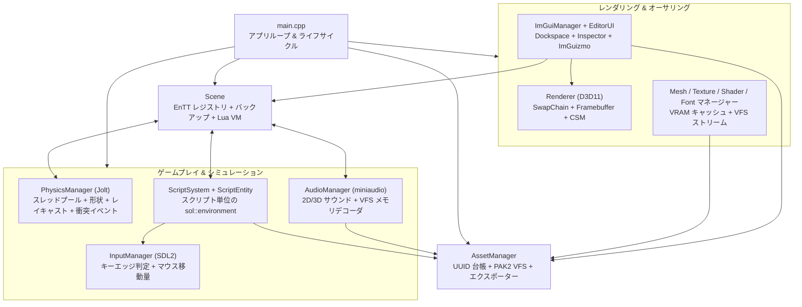

# サブシステム・物理・オーディオ・VFS

Step Engine のランタイムサブシステムは、2つの共有ハブを中心に連携します。1つは EnTT レジストリと `sol::state` Lua VM を所有する **`Engine::Scene`**、もう1つは 64 ビット UUID をディスクパスまたは `data.pak` VFS のバイト範囲へマッピングする **`Engine::AssetManager`** です。



---

## Jolt Physics 統合 (`PhysicsManager` & `PhysicsSystem`)

`PhysicsManager` (`src/Engine/PhysicsManager.cpp`) は以下の構成で **Jolt Physics** を初期化します。

- **メモリと並列処理**: ステップごとのロックフリー一時確保用に 128 MB の `JPH::TempAllocatorImpl` を確保し、`max(1, hardware_concurrency - 1)` 個のワーカースレッドを持つ `JPH::JobSystemThreadPool` を構成します。
- **ワールド容量**: 標準重力 `(0.0f, -9.81f, 0.0f)` のもとで、最大 `10,240` 個のリジッドボディ、`65,536` 組のボディペア、および `65,536` 個の接触拘束をサポートします。
- **コリジョンフィルタリング**: 2つのオブジェクトレイヤーおよびブロードフェーズレイヤーを使用します：
    - `Layers::NON_MOVING` (`0`) — 静的ボディ。`MOVING` ボディとのみ衝突します。
    - `Layers::MOVING` (`1`) — 動的ボディ。`NON_MOVING` と `MOVING` の両方と衝突します。

### コライダー形状・メッシュキャッシュ・ワールドスケーリング

`PhysicsManager::CreatePhysicsShape` は `RigidBodyComponent` から未スケールの基本形状を構築し、非単位ワールドスケール（`TransformComponent::worldMatrix` から `XMMatrixDecompose` で抽出）が存在する場合は `JPH::ScaledShape` でラップします。

| `RBShape` | Jolt 形状クラス | 使用される寸法パラメータ |
| :--- | :--- | :--- |
| `Box` | `JPH::BoxShape` | エンティティのワールドスケールで乗算された `halfExtent` (`x, y, z`) |
| `Sphere` | `JPH::SphereShape` | エンティティのワールドスケールで乗算された `radius` |
| `Capsule` | `JPH::CapsuleShape` | エンティティのワールドスケールで乗算された `halfHeight = height * 0.5f` および `radius` |
| `Mesh` *(Static)* | `JPH::MeshShape` | `MeshManager` (`positions` + `indices`) から生成される凹形状インデックス付き三角形リスト（`worldScale * colliderScale` でスケール） |
| `Mesh` *(Dynamic)* | `JPH::ConvexHullShape` | `MeshManager::GetMeshPositions` から構築される凸包（`worldScale * colliderScale` でスケール） |

構築されたメッシュ形状は `meshID` をキーとして `PhysicsManager::m_meshShapeCache` にキャッシュされるため、同一メッシュコライダーを複数配置しても凸包や BVH ツリーの再構築は発生しません。また、`Mesh` コライダーの `RigidBodyComponent::meshID` が `0` の場合、`PhysicsSystem` が同一エンティティの `MeshRendererComponent::meshID` から自動的に ID を引き継ぎます。

### ECS との双方向同期

- **Play モード (`isPlaying == true`)**:
    1. 高速移動時のすり抜け（トンネリング）を防ぐため、デルタタイムの上限を `1/30 s` (`0.0333s`) にクランプし、**4回のコリジョンサブステップ** で Jolt を更新します。
    2. キューに蓄積された衝突コールバックをメインスレッド上でフラッシュします。
    3. `JPH::BodyInterface` からワールド空間の位置と回転を取得し、`TransformComponent` に書き戻します。エンティティが親を持つ場合 (`RelationshipComponent`)、`PhysicsSystem` は親の逆ワールド行列を乗算してローカル空間へ変換します。このとき親も `RigidBodyComponent` を持っている場合は、1フレームの階層遅延を防ぐために Jolt から親の最新姿勢を *直接* 取得します。
- **Edit モード (`isPlaying == false`)**:
    - Inspector スライダーや `ImGuizmo` で変更された `TransformComponent::worldMatrix` を分解し、`SetPositionAndRotation` および `ResetBodyTransform` によって Jolt 側へ反映させ、線速度・角速度をゼロにリセットします。エンティティのスケールが変化した場合はボディを一旦破棄・無効化し、次フレームで `PhysicsSystem` がスケール済み形状と慣性テンソルを正確に再構築します。

### ハイブリッド・レイキャストとスレッドセーフな衝突イベント

- **ハイブリッド・レイキャスト (`Scene::CastRay`)**: まず `PhysicsManager::CastRay`（距離 1000 単位の `JPH::RRayCast` ナローフェーズクエリ）を実行します。物理コライダーにヒットしなかった場合は、リジッドボディを持たない有効な `TransformComponent` エンティティ（ライトやコライダーなしメッシュなど）に対して `Engine::Math::RayIntersectsOBB` による交差判定へフォールバックします。これにより、エディタビューポート上で全ての可視オブジェクトをクリック選択できます。
- **スレッドセーフな衝突ルーティング (`PhysicsContactListener`)**: Jolt はワーカースレッドから `OnContactAdded` と `OnContactRemoved` を呼び出します。リスナーは `m_eventMutex` をロックし、双方向の `{body1, body2, isEnter}` ペアを `m_eventQueue` に記録します。`m_physicsSystem->Update(...)` の完了直後、メインスレッド上で `FlushEvents()` がキューをスワップし、O(N) で `BodyID` を `entt::entity` ハンドルに解決して、アタッチされた Lua スクリプトの `OnCollisionEnter(other)` / `OnCollisionExit(other)` を安全に呼び出します。

---

## サンドボックス Lua スクリプティング (`sol2`)

ゲームプレイスクリプトは `Scene::m_lua`（`base`、`math`、`table`、`string` 標準ライブラリを開いた `sol::state`）内で実行されます。

- **インスタンス単位の環境分離**: エンティティの `LuaScriptComponent::scripts` ベクタ内の各 `ScriptInstance` は、独自の `sol::environment(scene.m_lua, sol::create, scene.m_lua.globals())` を生成し、`env["self"] = ScriptEntity(entity, &scene)` をバインドします。同じ `.lua` ファイルを複数のエンティティで実行した場合や、1つのエンティティに複数のスクリプトを付与した場合でも、グローバル変数や `OnUpdate` 関数が互いに衝突することはありません。
- **実行時の動的初期化 (On-The-Fly Initialization)**: ゲームプレイ中に `Entity:AddLuaScript(filepath)` でスクリプトが動的に追加された場合、`ScriptSystemUpdate` が `!script.isInitialized` を検出してスクリプトをコンパイルし、コールバックをキャッシュした上で初回の `OnUpdate(dt)` の直前に `OnCreate()` を呼び出します。
- **メモリ安全性とクラッシュ防止**:
    - `ScriptSystemInit`、`ScriptSystemUpdate`、`ScriptSystemShutdown` はいずれも処理開始時にエンティティハンドルをローカルの `std::vector<entt::entity>` にスナップショットし、インデックス経由でコンポーネント参照を再取得します。これにより、フレーム途中で `Instantiate` が呼ばれて EnTT プールが再確保されてもダングリング参照が発生しません。
    - すべてのスクリプト読み込み (`safe_script` / `safe_script_file`) とコールバック呼び出し (`sol::protected_function`) は Lua の構文エラー・実行時エラーを捕捉し、エンジンを異常終了させることなく `stderr` にエラー内容を出力します。

---

## 空間オーディオ (`AudioManager` & `AudioSystem`)

`AudioManager` (`src/Engine/AudioManager.cpp`) は、不透明な `void*` ハンドル（`ma_sound`、`ma_decoder`、および VFS バッファ用 `std::vector<char>` を保持する `AudioInstance` 構造体）の背後に `miniaudio` (`ma_engine`) をラップしています。

- **Editor と VFS のデコード切り替え**: Editor モードでは、`LoadSound` は `ma_sound_init_from_file` を用いてディスクから直接読み込み・ストリーミングを行います。VFS 有効時 (`DIST_BUILD`) は、`AudioInstance` が `data.pak` から抽出したバイト配列をサウンドの生存期間中メモリに保持し、`ma_decoder_init_memory` + `ma_sound_init_from_data_source` でインメモリデコードを行います。
- **毎フレームの 3D 空間同期 (`AudioSystem`)**: リスナー `0` の位置とクォータニオン回転後の `+Z` 前方ベクトルをアクティブカメラに同期し、`AudioComponent::soundHandle` の遅延ロード、`playOnCreate` サウンドの再生開始、非アクティブ化されたエンティティの再生停止、および `TransformComponent::worldMatrix` から分解したワールド座標による 3D エミッター位置の更新を行います。

---

## アセットパイプライン・`PAK2` VFS・スタンドアロンエクスポート

### UUID レジストリと仮想アセットパス

`AssetManager` (`src/Engine/AssetManager.cpp`) は、インポートされたすべてのファイルやプロシージャルリソースに対してランダムな 64 ビット `Engine::UUID` (`std::mt19937_64`) を割り当てます。パスによる重複排除が行われるため、同じパスを再度インポートすると常に既存の UUID が返されます。物理ファイルパスに加え、エンジン内部では以下の仮想 URI 規約を使用しています。

| 仮想パスパターン | `AssetType` | 意味 |
| :--- | :--- | :--- |
| `primitive://cube`, `primitive://quad`, `primitive://sphere_...`, `primitive://capsule_...` | `Mesh` | `MeshManager` が生成するプロシージャルジオメトリ |
| `primitive://white`, `primitive://default_normal`, `primitive://default_orm` | `Texture` | `TextureManager` が生成する 1x1 フォールバックテクスチャ |
| `cubemap://<first_face_path>` | `Texture` | 6面キューブマップ全体の SRV エントリ（各物理画像ファイルも個別に登録されます） |
| `shader://basic`, `shader://unlit`, `shader://skybox`, `shader://shadow`, `shader://sprite` | `Shader` | 論理シェーダーパイプライン識別子（ディスク / VFS 上の実体は `shaders/*.cso`） |
| `<model_path>?mesh=<index>` | `Mesh` | `<model_path>` (`ModelFile`) から Assimp が抽出した個別サブメッシュ |
| `<ttf_path>?size=<float>` | `Font` | 指定ピクセルサイズでベイクされた `stb_truetype` グリフアトラス（実体は `<ttf_path>`） |

### `PAK2` バイナリアーカイブ形式と透過的 VFS

`AssetManager::PackAssets` は、レジストリ内のすべての物理アセットを単一のバイナリファイル `data.pak` にコンパイルします。

```text
+-------------------------------------------------------------------+
| Header (8 bytes)                                                  |
|   char magic[4]      = "PAK2"                                     |
|   uint32_t count     = total registry entries                     |
+-------------------------------------------------------------------+
| Dynamic Table of Contents (TOC) [repeated `count` times]          |
|   uint64_t uuid      (8 bytes)                                    |
|   uint32_t type      (4 bytes, Engine::AssetType)                 |
|   uint32_t pathLen   (4 bytes)                                    |
|   char filepath[pathLen]                                          |
|   uint64_t offset    (8 bytes, byte offset into payload section)  |
|   uint64_t size      (8 bytes, 0 for virtual/procedural entries)  |
+-------------------------------------------------------------------+
| Concatenated Raw Binary Payloads                                  |
|   [Raw bytes of models, .mtl/.bin sidecars, textures, .cso,       |
|    audio clips, .ttf fonts, .lua scripts, and .json scenes]       |
+-------------------------------------------------------------------+
```

`DX11Runtime` が `AssetManager::MountVFS("data.pak")` を呼び出すと、メモリ上に `m_assetRegistry` と `m_vfsTable` が再構築されます。以降すべてのローダーは `ReadAssetFromVFS(uuid)` によるメモリバッファ読み込みへと透過的に切り替わります。Assimp もカスタム実装の `VFSIOSystem` と `VFSIOStream` (`src/Engine/MeshManager.cpp`) を使用するため、`.mtl` や `.bin` などの関連ファイルをアーカイブ内から直接解決できます（Editor でのインポート時にもこれらの付随ファイルは自動的にレジストリへ登録されます）。

### スタンドアロンゲームのエクスポートパイプライン (`AssetManager::ExportProject`)

エディタツールバーの **Export Game** をクリックすると、以下の5ステップからなるパッケージングパイプラインが実行されます。


