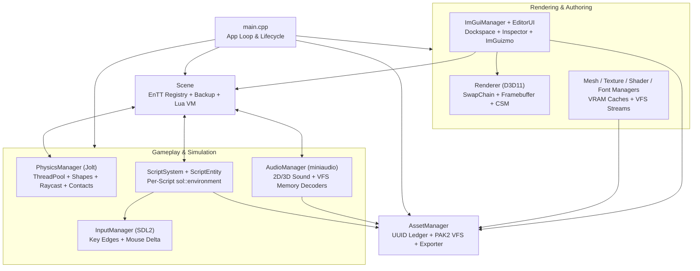

# Subsystems, Physics, Audio & VFS

Step Engine coordinates its runtime subsystems around two shared hubs: **`Engine::Scene`** (which owns the EnTT registry and `sol::state` Lua VM) and **`Engine::AssetManager`** (which maps 64-bit UUIDs to disk paths or `data.pak` VFS byte ranges).



---

## Jolt Physics Integration (`PhysicsManager` & `PhysicsSystem`)

`PhysicsManager` (`src/Engine/PhysicsManager.cpp`) initializes **Jolt Physics** with:

- **Memory & Concurrency**: A 128 MB `JPH::TempAllocatorImpl` for lock-free per-step allocations and a `JPH::JobSystemThreadPool` configured with `max(1, hardware_concurrency - 1)` worker threads.
- **World Capacity**: Up to `10,240` rigid bodies, `65,536` body pairs, and `65,536` contact constraints under standard earth gravity `(0.0f, -9.81f, 0.0f)`.
- **Collision Filtering**: Two object and broadphase layers:
    - `Layers::NON_MOVING` (`0`) — Static bodies; collides *only* with `MOVING` bodies.
    - `Layers::MOVING` (`1`) — Dynamic bodies; collides with both `NON_MOVING` and `MOVING` bodies.

### Collider Shapes, Mesh Caching & World Scaling

`PhysicsManager::CreatePhysicsShape` builds an unscaled base shape from `RigidBodyComponent` and wraps non-identity world scales (extracted from `TransformComponent::worldMatrix` via `XMMatrixDecompose`) in a `JPH::ScaledShape`:

| `RBShape` | Jolt Shape Type | Dimensions Used |
| :--- | :--- | :--- |
| `Box` | `JPH::BoxShape` | `halfExtent` (`x, y, z`) scaled by entity world scale |
| `Sphere` | `JPH::SphereShape` | `radius` scaled by entity world scale |
| `Capsule` | `JPH::CapsuleShape` | `halfHeight = height * 0.5f` and `radius` scaled by entity world scale |
| `Mesh` *(Static)* | `JPH::MeshShape` | Concave indexed triangle list from `MeshManager` (`positions` + `indices`), scaled by `worldScale * colliderScale` |
| `Mesh` *(Dynamic)* | `JPH::ConvexHullShape` | Convex hull built from `MeshManager::GetMeshPositions`, scaled by `worldScale * colliderScale` |

Built mesh shapes are cached in `PhysicsManager::m_meshShapeCache` keyed by `meshID` so instancing multiple mesh colliders avoids redundant hull/tree construction. If `RigidBodyComponent::meshID` is `0` on a `Mesh` collider, `PhysicsSystem` automatically wires it from the entity's `MeshRendererComponent::meshID`.

### Bidirectional ECS Synchronization

- **Play Mode (`isPlaying == true`)**:
    1. Steps Jolt with delta time clamped to `1/30 s` (`0.0333s`) across **4 collision sub-steps** to prevent high-speed tunneling.
    2. Flushes queued collision callbacks on the main thread.
    3. Pulls world-space position and rotation from `JPH::BodyInterface` back into `TransformComponent`. If the entity is parented (`RelationshipComponent`), `PhysicsSystem` multiplies by the inverse parent world matrix—querying Jolt *directly* if the parent also has a `RigidBodyComponent` to eliminate 1-frame hierarchy lag.
- **Edit Mode (`isPlaying == false`)**:
    - Pushes decomposed `TransformComponent::worldMatrix` changes (from Inspector sliders or `ImGuizmo`) into Jolt via `SetPositionAndRotation` and `ResetBodyTransform`, zeroing linear/angular velocity. If the entity's scale changed, the body is destroyed and invalidated so `PhysicsSystem` rebuilds its scaled shape and inertia tensor cleanly on the next frame.

### Hybrid Raycasting & Thread-Safe Contact Events

- **Hybrid Raycasting (`Scene::CastRay`)**: Queries `PhysicsManager::CastRay` (1000-unit `JPH::RRayCast` narrow-phase query) first. If no physics collider is hit, it falls back to testing `Engine::Math::RayIntersectsOBB` against non-rigidbody active `TransformComponent` entities (such as lights or uncollided meshes) so Editor viewport picking works on every visible object.
- **Thread-Safe Collision Routing (`PhysicsContactListener`)**: Jolt invokes `OnContactAdded` and `OnContactRemoved` from worker threads. The listener locks `m_eventMutex` and records `{body1, body2, isEnter}` pairs for both directions into `m_eventQueue`. Immediately after `m_physicsSystem->Update(...)` finishes, `FlushEvents()` swaps the queue on the main thread, maps `BodyID`s to `entt::entity` handles in O(N), and invokes `OnCollisionEnter(other)` / `OnCollisionExit(other)` on attached Lua scripts.

---

## Sandboxed Lua Scripting (`sol2`)

Gameplay scripts execute inside `Scene::m_lua` (`sol::state` with `base`, `math`, `table`, and `string` standard libraries).

- **Per-Instance Environment Isolation**: Each `ScriptInstance` inside an entity's `LuaScriptComponent::scripts` vector creates its own `sol::environment(scene.m_lua, sol::create, scene.m_lua.globals())` and binds `env["self"] = ScriptEntity(entity, &scene)`. Multiple entities running the same `.lua` file—or multiple scripts on one entity—never overwrite each other's globals or `OnUpdate` functions.
- **On-The-Fly Initialization**: If a script is attached dynamically during gameplay via `Entity:AddLuaScript(filepath)`, `ScriptSystemUpdate` detects `!script.isInitialized`, compiles the script, caches its callbacks, and runs `OnCreate()` immediately before its first `OnUpdate(dt)`.
- **Memory & Crash Safety**:
    - `ScriptSystemInit`, `ScriptSystemUpdate`, and `ScriptSystemShutdown` snapshot entity handles into a local `std::vector<entt::entity>` and re-fetch component references by index so mid-frame `Instantiate` calls that reallocate EnTT pools never dangle C++ references.
    - All script loads (`safe_script` / `safe_script_file`) and callbacks (`sol::protected_function`) trap Lua syntax and runtime errors, logging diagnostics to `stderr` instead of terminating the engine.

---

## Spatial Audio (`AudioManager` & `AudioSystem`)

`AudioManager` (`src/Engine/AudioManager.cpp`) wraps `miniaudio` (`ma_engine`) behind opaque `void*` handles (`AudioInstance` structs containing `ma_sound`, `ma_decoder`, and a `std::vector<char>` VFS buffer).

- **Editor vs. VFS Decoding**: In Editor mode, `LoadSound` streams/loads from disk via `ma_sound_init_from_file`. When VFS is active (`DIST_BUILD`), `AudioInstance` retains the extracted `data.pak` byte vector in memory for the lifetime of the sound and decodes it via `ma_decoder_init_memory` + `ma_sound_init_from_data_source`.
- **Per-Frame 3D Spatialization (`AudioSystem`)**: Updates listener `0` with the active camera's position and quaternion-rotated `+Z` forward vector, lazily initializes `AudioComponent::soundHandle`, triggers `playOnCreate` sounds, stops sounds on deactivated entities, and updates 3D emitter positions from decomposed `TransformComponent::worldMatrix` translations.

---

## Asset Pipeline, `PAK2` VFS & Standalone Export

### UUID Registry & Virtual Asset Paths

`AssetManager` (`src/Engine/AssetManager.cpp`) assigns every imported file or procedural resource a random 64-bit `Engine::UUID` (`std::mt19937_64`), deduplicating paths so importing the same path twice always returns the existing UUID. In addition to disk filepaths, the engine uses virtual URI conventions:

| Virtual Path Pattern | `AssetType` | Meaning |
| :--- | :--- | :--- |
| `primitive://cube`, `primitive://quad`, `primitive://sphere_...`, `primitive://capsule_...` | `Mesh` | Procedural geometry generated by `MeshManager` |
| `primitive://white`, `primitive://default_normal`, `primitive://default_orm` | `Texture` | 1x1 fallback textures generated by `TextureManager` |
| `cubemap://<first_face_path>` | `Texture` | Combined 6-face cubemap SRV entry (each physical face is also registered individually) |
| `shader://basic`, `shader://unlit`, `shader://skybox`, `shader://shadow`, `shader://sprite` | `Shader` | Logical shader pipeline identifiers (backed on disk/VFS by `shaders/*.cso`) |
| `<model_path>?mesh=<index>` | `Mesh` | Individual sub-mesh extracted by Assimp from `<model_path>` (`ModelFile`) |
| `<ttf_path>?size=<float>` | `Font` | Baked `stb_truetype` glyph atlas at a specific pixel height (backed by `<ttf_path>`) |

### `PAK2` Binary Archive Format & Transparent VFS

`AssetManager::PackAssets` compiles all physical assets in the registry into a single binary `data.pak` archive:

```text
+-------------------------------------------------------------------+
| Header (8 bytes)                                                  |
|   char magic[4]      = "PAK2"                                     |
|   uint32_t count     = total registry entries                     |
+-------------------------------------------------------------------+
| Dynamic Table of Contents (TOC) [repeated `count` times]          |
|   uint64_t uuid      (8 bytes)                                    |
|   uint32_t type      (4 bytes, Engine::AssetType)                 |
|   uint32_t pathLen   (4 bytes)                                    |
|   char filepath[pathLen]                                          |
|   uint64_t offset    (8 bytes, byte offset into payload section)  |
|   uint64_t size      (8 bytes, 0 for virtual/procedural entries)  |
+-------------------------------------------------------------------+
| Concatenated Raw Binary Payloads                                  |
|   [Raw bytes of models, .mtl/.bin sidecars, textures, .cso,       |
|    audio clips, .ttf fonts, .lua scripts, and .json scenes]       |
+-------------------------------------------------------------------+
```

When `DX11Runtime` calls `AssetManager::MountVFS("data.pak")`, the engine reconstructs `m_assetRegistry` and `m_vfsTable` in memory. Every loader switches seamlessly to memory-buffered reads via `ReadAssetFromVFS(uuid)`—including Assimp, which uses a custom `VFSIOSystem` and `VFSIOStream` (`src/Engine/MeshManager.cpp`) to resolve `.mtl`, `.bin`, and relative model dependencies directly from the archive (and automatically register those sidecar files during Editor imports).

### Standalone Game Export Pipeline (`AssetManager::ExportProject`)

Clicking **Export Game** in the Editor toolbar executes a 5-step packaging pipeline:


